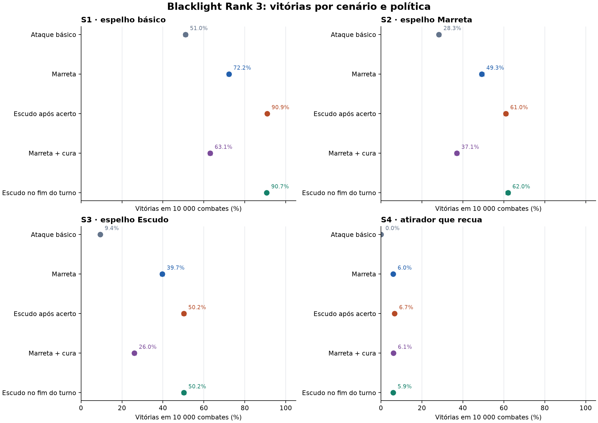
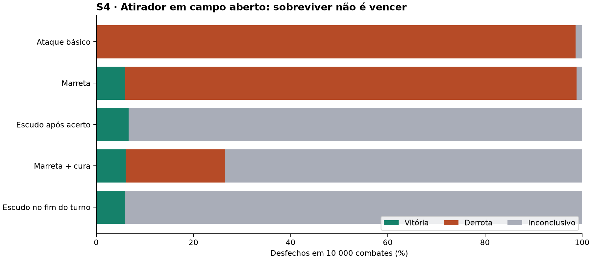

# Blacklight Rank 3 — relatório de duelos verificáveis

**Versão de 27/10/2026.** Este é um estudo **restrito de duelos**, não uma simulação integral do *Marvel Multiverse Role-Playing Game*. Os resultados dizem respeito à ficha Rank 3 atual, às decisões da mesa registradas e aos adversários e políticas explicitamente definidos abaixo. O [manual prático](MANUAL_BLACKLIGHT.md) e o [guia rápido](QUICK_REFERENCE.md) traduzem as conclusões para a sessão.

Expansões posteriores de três participantes e de Mental Punch estão nos relatórios exploratórios de [grupo](GROUP_REPORT.md) e [Focus](FOCUS_REPORT.md). Elas não alteram as estimativas confirmatórias deste documento.

## 1. Pergunta e resposta sustentada

Pergunta: entre dez políticas explícitas, qual usa melhor Victor Halle/Blacklight contra os quatro adversários testados, sem confundir dano teórico, sobrevivência e vitória? A evidência confirmatória favorece **Marreta como ataque padrão com Escudo ativado por reação** nos três duelos próximos. Tanto ativar após ver um acerto (P8) quanto ao fim do próprio turno (P10) superaram Marreta sem Escudo (P3), e a diferença entre P8 e P10 não foi resolvida pelos dados. Contra um atirador que recua em campo aberto, o Escudo muda sobretudo **derrota para inconclusão**; não resolve o problema de alcançá-lo. Portanto a recomendação é **condicional**, não uma estratégia globalmente ótima.

## 2. Fontes, ficha e fronteira normativa

O [registro de regras](RULES_AUDIT.md) liga cada operação a um ID e página do *Core Rulebook* de 2023, à [FAQ oficial de março/2025](https://cdn.marvel.com/u/prod/marvel/i/pdf/MMRPG_Rules-FAQ_20250327.pdf), à [errata oficial de julho/2025](https://cdn.marvel.com/u/prod/marvel/i/pdf/MMRPG_Errata_20250718.pdf) ou à decisão da mesa. As decisões da mesa prevalecem. A [auditoria da ficha](CHARACTER_AUDIT.md) mostra que o PDF atual de Downloads tem **Health 150, Focus 90, Melee 6, Resilience 5, Mighty 3, Sturdy 1, Combat Reflexes, Healing Factor, Fast Strikes, Riposte e Attack Stance**, mas **não** Extended Reach. O resumo inicial de Focus 60/Extended Reach veio de outra ficha e não foi misturado com esta.

Regras caseiras decisivas: Marreta acrescenta `+2` ao multiplicador além do Mighty 3 e causa **Stunned** em sucesso fantástico; Escudo Rank 3 reduz em `2` o multiplicador de ataques Melee/Agility e soma com Sturdy 1, totalizando DR `3` quando ativo. A ativação usa ação padrão ou reação, inclusive ao fim do turno próprio ou após ver um acerto inimigo, protegendo já esse ataque. O Escudo persiste até desativação gratuita e precisa ser desativado antes de atacar com Marreta/Lâmina. Não integra Fast Strikes. A Lâmina pode gerar uma segunda ação com nova rolagem somente após o **primeiro acerto fantástico no próprio turno**; um Riposte fantástico não a gera. Chicote está indisponível no Rank 3. Essas afirmações são decisões comunicadas pelo usuário, não texto inventado para o PDF.

O Core p.29 fala em reação por rodada e também em retorno no começo do próximo turno; a errata do Combat Reflexes assegura uma reação adicional **por rodada**. O motor escolhe conservadoramente **duas reações por rodada**, renovadas no começo da rodada, e nunca duas no mesmo gatilho. Este instante de renovação não está confirmado pela mesa. A combinação de edge de Signature Attack com Blazing-Fast Fists também depende do narrador; a análise principal usa **uma** edge, e a variante com duas fica separada.

## 3. Motor, adversários e desenho experimental

O pacote `blacklight/` separa dado, dano, estado/transição, políticas, experimentos e auditoria de trilhas. O motor não pede a um modelo de linguagem para resolver rolagens. `random.Random` recebe semente determinística de SHA-256 de estágio, cenário, política e índice. Cada JSON registra hashes de código e especificações, versão do Python, contagens e métricas; políticas diferentes usam **amostras independentes**, mesmo quando o índice coincide. Um combate termina na primeira incapacitação (Health < 1), ou após **30 rodadas**, quando é inconclusivo. A rodada bônus da iniciativa fantástica é representada.

As dez políticas P1–P10 constam em [EXPERIMENT_SPEC.md](EXPERIMENT_SPEC.md). P1 ataca sem arma; P2 abre Attack Stance; P3 usa Marreta; P4 combina Lâmina + Marreta em Fast Strikes; P5 cura cedo; P6 usa Lâmina + Escudo reativo; P7 combina Stance, Marreta e cura; P8 usa Marreta e ativa Escudo após um acerto; P9 é a cura com limiar 75/15 Focus selecionada por busca pré-definida; P10 usa Marreta e ativa Escudo ao fim do turno. Todas usam Riposte quando legal e escolha de edge observando a rolagem atual, nunca dados futuros.

| Cenário | Perfil e intenção do adversário | Distância inicial |
|---|---|---:|
| S1 `mirror_attack` | Espelho Rank 3, ataque básico e Riposte; controle simétrico. | 1 |
| S2 `mirror_hammer` | Espelho com Marreta, Stunned e Riposte; quebra planos ofensivos. | 1 |
| S3 `mirror_shield` | Espelho com Marreta e Escudo ativado por reação depois de acerto; DR total 3. | 1 |
| S4 `gunner_kiter` | Sintético Rank 3, Agility 6, Run 6, munição, ataque e recuo; trata Bleeding e, quando alcançado por perseguidor igualmente rápido, gasta também a ação padrão para recuar. | 8 |

O [pré-registro](EXPERIMENT_SPEC.md) fixou quatro cenários, dez políticas, vitória/derrota/inconclusão, dano por horizontes 3/5/10, recursos, cura, mitigação e 10 000 sementes novas por célula confirmatória. A exploração teve 1000 por célula (40 000); a busca de cura teve 18 000; a confirmação teve **400 000**. A sensibilidade usou 11 pares de variantes, 3000 por lado (66 000). Experimentos antigos em `results/` com prefixos `pre_`/`invalid_` foram mantidos para histórico, **excluídos** destas conclusões. A amostra suplementar de 20 000 trilhas e os três cenários reservados estão descritos abaixo.

## 4. Validação antes de interpretar vitórias

A suíte atual passou **84/84 testes** (`python -m unittest discover -s tests -q`): 58 do núcleo/duelos congelados antes da confirmação, três da primitiva experimental de Fast Strikes multi-alvo, onze do protótipo de grupo e doze de Focus, adicionados depois sem alterar os hashes do núcleo. Oráculos independentes enumeram os 216 resultados básicos d616, 36 Fantastic rolls e o único Ultimate Fantastic; casos forçados cobrem edge/trouble, dano, DR antes da metade/dobro, economia de ações, reação, Riposte, Marreta, Lâmina, Escudo, movimento, Bleeding, Stunned e cura. O auditor `blacklight/audit.py` recalcula classificação das rolagens, dano e saldos de Health/Focus sem importar as funções de dano/dado do motor, e rejeita orçamento de reações renovado duas vezes na mesma rodada. Além de **4000** duelos completos da suíte cruzada, [SECONDARY_SPEC.md](SECONDARY_SPEC.md) e [secondary_summary.json](results/secondary_summary.json) registram **20 000 trilhas completas adicionais auditadas**, sem divergência. Quatro [demonstrações completas](DEMONSTRATIONS.md) mostram sementes, rolagens, eventos, custos e estado final.

Essa validação prova consistência das mecânicas **implementadas** com os oráculos e decisões usadas; não transforma as lacunas do jogo inteiro em regras testadas. A [revisão adversarial](REVIEW_FINDINGS.md) detectou e levou à correção de knockback, movimento duplo, escolha de edge, reações, Bleeding tratado pelo atirador, recuo duplo e, por fim, o Escudo indevidamente usado em Fast Strikes. O [histórico](CHANGELOG.md) conserva essas mudanças e os resultados antigos excluídos.

## 5. Confirmação: vitórias e incerteza

Cada célula abaixo representa **10 000 combates independentes**. Valores são taxa de vitória de Victor em %, com **IC Wilson de 95%** entre colchetes. Não há empates nos cenários confirmatórios. O limite superior real dos casos 0/10 000 é aproximadamente **0,04%**, arredondado para `0,0` na tabela. S1–S4 são cenários artificiais declarados, sem pesos que representem a campanha.

| Política | S1 vitória % [IC95] | S2 | S3 | S4 |
|---|---:|---:|---:|---:|
| P1 `bare_attack` | 51,0 [50,0; 52,0] | 28,3 [27,5; 29,2] | 9,4 [8,8; 10,0] | 0,0 [0,0; 0,04] |
| P2 `stance_bare` | 36,9 [36,0; 37,9] | 27,8 [26,9; 28,7] | 13,1 [12,5; 13,8] | 0,0 [0,0; 0,04] |
| P3 `hammer` | 72,2 [71,3; 73,1] | 49,3 [48,3; 50,3] | 39,7 [38,7; 40,7] | 6,0 [5,5; 6,4] |
| P4 `blade_hammer_fast` | 50,4 [49,4; 51,4] | 30,5 [29,6; 31,4] | 19,2 [18,4; 19,9] | 3,2 [2,8; 3,5] |
| P5 `hammer_heal` | 60,9 [60,0; 61,9] | 25,5 [24,7; 26,4] | 17,8 [17,0; 18,5] | 6,4 [5,9; 6,9] |
| P6 `shield_blade_reactive` | 47,9 [46,9; 48,8] | 18,8 [18,0; 19,5] | 4,8 [4,4; 5,3] | 0,0 [0,0; 0,04] |
| P7 `hybrid` | 53,0 [52,0; 53,9] | 32,7 [31,8; 33,6] | 25,3 [24,5; 26,2] | 6,1 [5,6; 6,6] |
| P8 `shield_hammer_reactive` | 90,9 [90,3; 91,4] | 61,0 [60,0; 61,9] | 50,2 [49,2; 51,2] | 6,7 [6,2; 7,2] |
| P9 `hammer_heal_t75_s15` | 63,1 [62,1; 64,0] | 37,1 [36,1; 38,0] | 26,0 [25,2; 26,9] | 6,1 [5,6; 6,6] |
| P10 `shield_hammer_endturn` | 90,7 [90,1; 91,2] | 62,0 [61,1; 63,0] | 50,2 [49,3; 51,2] | 5,9 [5,5; 6,4] |



O [gráfico em PNG](results/fig_win_rates.png) e sua [versão SVG](results/fig_win_rates.svg) mostram cinco políticas principais com ICs. A diferença P8 − P3 em pontos percentuais foi **+18,67** em S1 (IC simultâneo [17,34; 20,00]), **+11,66** em S2 ([9,92; 13,40]) e **+10,49** em S3 ([8,74; 12,24]). Em S4 foi +0,72 ([-0,14; 1,58]), sem evidência clara de maior chance de vitória. Esses ICs usam amostras Bernoulli independentes e Bonferroni para as quatro comparações desta família, sem pareamento artificial de sementes.

Entre P8 e P10, as diferenças P8 − P10 foram +0,19, −1,06, −0,05 e +0,74 pontos em S1–S4, respectivamente. Os quatro ICs simultâneos incluem zero; **o momento preferível para ativar o Escudo não está determinado** por estas comparações. A decisão prática deve considerar se um golpe está iminente e quanto vale guardar a reação para Riposte.

### S4: o que a taxa de vitória não mostra

| Política | Vitória | Derrota | Inconclusivo aos 30 |
|---|---:|---:|---:|
| P1 ataque básico | 0,00% | 98,62% | 1,38% |
| P3 Marreta | 5,96% | 92,91% | 1,13% |
| P8 Marreta + Escudo após acerto | 6,68% | **0,00%** | **93,32%** |
| P9 Marreta + cura | 6,07% | 20,45% | 73,48% |
| P10 Marreta + Escudo fim do turno | 5,94% | **0,00%** | **94,06%** |



A imunidade do Escudo à munição é responsável pela ausência de derrotas de P8/P10 em S4 **neste modelo**. A distância e o recuo mantêm Victor longe demais para converter a sobrevivência em vitória. Aos 30 turnos, os resultados são censurados; não devem ser renomeados vitória. O [gráfico de desfechos](results/fig_s4_outcomes.svg) deixa essa distinção visível.

## 6. Cenários não usados para ajustar as finalistas

O [pré-registro reservado](HOLDOUT_SPEC.md) fixou P1/P3/P8/P9/P10 e 10 000 sementes novas por célula. H1 e H3 variam **somente a distância inicial** de S2 e S4, respectivamente. H2 corrigido altera Resilience do defensor, o que deriva Health e Healing Factor. Sua primeira versão usou Health incompatível com a fórmula do Core e foi arquivada; por essa exposição prévia ao resultado, **H2 corrigido é exploratório**, não uma confirmação reservada pura.

| Cenário | P3 Marreta | P8 Escudo após acerto | P10 Escudo fim do turno | Leitura |
|---|---:|---:|---:|---|
| H1 `mirror_hammer_d8`, reservado | 49,67% | 61,02% | 61,03% | P8 − P3 = +11,35 pp, IC simultâneo [9,68; 13,02]. A vantagem próxima reapareceu após aproximação inicial. |
| H2 `mirror_shield_r6`, **exploratório corrigido** | 29,34% | 40,86% | 40,40% | P8 − P3 = +11,52 pp, [9,92; 13,12]. Consistente com vantagem contra defensor mais resistente, mas não confirma independentemente essa hipótese. |
| H3 `gunner_kiter_d1`, reservado | 24,06% | 24,21% | 23,47% | P8 − P3 = +0,15 pp, [−1,30; 1,60]. Começar em alcance ajuda todas as políticas, mas Escudo não resolve a fuga depois disso. |

Os ICs de diferença acima usam Bonferroni para três comparações P8 − P3; H2 fica rotulado exploratório independentemente do IC. Em H3, P8 teve **75,79% inconclusivos** e nenhuma derrota; P3 teve **74,86% derrotas** e 1,08% inconclusivos. A escolha entre resistir e encerrar a luta depende do objetivo da cena. O [JSON reservado](results/holdout_summary.json) traz todas as 15 células e hashes; o snapshot inválido de H2 permanece identificável, sem entrar nesta tabela.

## 7. Sensibilidade, distribuição e refutação

A [análise de sensibilidade](results/sensitivity.json) usou 3000 sementes independentes por lado e não alterou o resultado principal. Usar os campos literais conflitantes da ficha (Initiative +1, Run 6) em vez dos derivados do Core (+2, Run 5) reduziu a vitória de P3 em **1,9 pp** em S1, **3,1 pp** em S2 e **0,5 pp** em S4; somente o intervalo exploratório de S2 excluiu zero (aprox. [−5,7; −0,6] pp). Inverter a ordem de Healing Factor e Bleeding no fim do turno produziu diferenças de −1,8 a +1,0 pp nas quatro células com Lâmina; todos os ICs incluíram zero. Permitir **duas edges** em Fast Strikes, por outro lado, elevou P4/P6 em **13 a 24 pp** nas células S1/S2 testadas. Isso é uma variante **dependente do mestre**, não um bônus da análise principal, e não prova que Lâmina superaria Escudo + Marreta em todas as situações.

A amostra suplementar independente de [20 000 combates auditados](results/secondary_summary.json) mostra por que não basta uma média. Em S2, o dano total de P3 teve quantis 10/50/90 de **27/157/212** Health; P8 teve **41/178/226**. A sobrevivência até o fim da rodada 5 foi 47,8% para P3 e 62,7% para P8 nesse lote de 1000 por célula. Em S4, ambos tiveram **mediana de dano causado 0** e sobrevivência até a rodada 5 próxima de 100%; isso não se traduziu em vitória até a rodada 30. O dano por turno próprio foi calculado por combate, incluindo rodada bônus e todos os inícios, mas pode incluir Health negativo após a incapacitação; seu valor não é o dano mínimo necessário para vencer.

A revisão adversarial testou hipóteses específicas: bônus de multiplicador ilegais; Escudo em Fast Strikes; Riposte/segunda ação da Lâmina; cura e sangramento na ordem incorreta; duas reações no mesmo gatilho ou renovação duas vezes na rodada; atirador que nunca trata sangramento; perseguição contra fuga dupla; vantagem estatística de um único cenário. Cada defeito encontrado gerou correção, novo teste e invalidação explícita dos snapshots antigos. Não surgiu uma política que **derrote** o atirador de forma consistente em campo aberto: esta é uma refutação material da ideia de pressão contínua como plano universal.

Três [stress tests exploratórios adicionais](ADVERSARIAL_SPEC.md), **5000 duelos por célula**, tentaram transportar a conclusão para poder relativo diferente. Contra um espelho com Marreta de **Rank 4**, P3 venceu 45,58%, P8 54,72% e P10 56,80%: o Escudo ainda ajudou, mas com margem menor que em S1. Contra um brawler sintético de Rank 2, todas as cinco políticas fixas venceram 100%, cenário fácil demais para distinguir estratégias. Contra um **atirador Rank 4 de ataque não classificado como munição**, P8 venceu 5,94%, perdeu **46,40%** e terminou inconclusivo em 47,66%; P3 venceu 6,46% e perdeu 93,48%. Assim, a ausência de derrotas de P8 em S4 depende materialmente da classificação do ataque como munição **e** da força do atacante. Este último perfil é uma sonda mecânica abstrata, sem poder/range identificado numa ficha oficial, e muda Rank e tipo de ataque ao mesmo tempo; não é uma estimativa da frequência de tal inimigo na campanha. O [JSON adversarial](results/adversarial_summary.json) guarda perfis, políticas, sementes e hashes.

## 8. Conclusão prática e limites ainda abertos

**Em duelo próximo com a ficha atual**, Marreta + Escudo defensivo foi a combinação mais robusta entre as dez políticas e três adversários próximos confirmados. A Marreta comum supera o Fast Strikes de alvo único com Lâmina+Marreta quando o objetivo medido é vitória no duelo. Cura automática e abertura fixa de Attack Stance frequentemente cedem turnos de ataque valiosos. A escolha entre ativar Escudo ao fim do turno e esperar um acerto permanece situacional. O [manual](MANUAL_BLACKLIGHT.md) explica a sequência de ações e os gatilhos sem exigir a leitura destas tabelas.

**Limites que impedem uma conclusão geral sobre o RPG:** o motor de duelos tem dois combatentes, sem mapa/obstáculos, cobertura, grupos coordenados, múltiplos alvos dentro de um combate, inimigos de controle/Focus, Karma, recuperação entre lutas ou tática de aliados. Um [protótipo experimental de grupo](GROUP_REPORT.md) integra Fast Strikes contra dois alvos distintos em contato fixo, mas **não** integra a simulação confirmatória nem as regras caseiras de armas nos dois braços contra vários alvos. O membro inutilizado da Lâmina é registrado, mas não recebeu penalidade numérica; fogo não foi testado; imunidade a munição segue a decisão da mesa sem modelar exceções; a renovação exata das reações e o acúmulo de edges ainda dependem de interpretação/decisão; as políticas adversárias são explícitas e competentes para seus perfis, mas não representam toda a criatividade de um mestre. Não há perfis oficiais de inimigo nesta bateria. Essas lacunas significam que este relatório **não satisfaz ainda** o escopo de todos os adversários, grupos e terreno da missão original; suas recomendações ficam limitadas aos cenários executados.

## 9. Reproduzir e conferir

Na pasta do projeto, com Python 3.11+:

```powershell
python -m unittest discover -s tests -q
python -m blacklight.search
python -m blacklight.experiment --stage dev --n 1000 --output results/dev_summary.json
python -m blacklight.experiment --stage confirm --n 10000 --output results/confirm_summary.json
python -m blacklight.sensitivity
python -m scripts.holdout
python -m scripts.secondary_metrics
python -m scripts.adversarial_scenarios
python -m scripts.replay --scenario mirror_shield --strategy shield_hammer_reactive --index 0 --output results/replay.json
```

O [README](README.md) descreve os arquivos. `source_sha256` deve coincidir com os arquivos atuais de `blacklight/`, [EXPERIMENT_SPEC.md](EXPERIMENT_SPEC.md), [RULES_AUDIT.md](RULES_AUDIT.md) e [CHARACTER_AUDIT.md](CHARACTER_AUDIT.md). Os scripts suplementares incluem hashes próprios e seus pré-registros. As figuras foram feitas com Matplotlib a partir do JSON confirmatório; seu [manifesto de proveniência](results/figures_manifest.json) guarda os hashes da fonte, dos dados e do script. Elas são ilustrações dos mesmos resultados tabulados, não experimentos adicionais.

